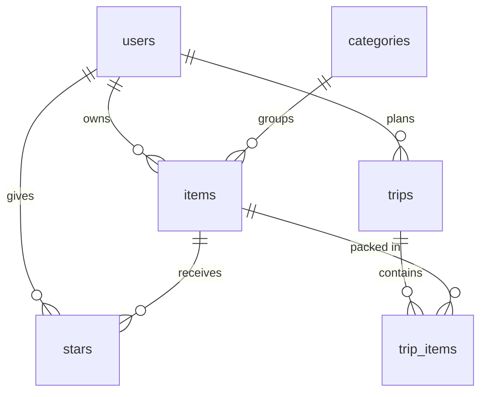

# Closet Catalog — Plan

## 1. Pitch

I'm building **Closet Catalog**, a wardrobe catalogue that remembers what I own and helps me pack, because MBA life means constant trips (treks, conferences, recruiting, weddings) in very different climates. Right before every trip I forget what I actually own that works for "cold + business casual" or "beach + one nice dinner."

I'll use it **weekly**: whenever I buy something (add it), and before every trip (filter by season and formality, then build a packing list). Friends and I constantly ask each other *"what are you packing?"*, so each trip's packing list can be shared with a read-only link.

## 2. Features

Built in this order, one PR each.

**Spine**

1. **Sign up and login.** As a new visitor, I want to create an account with my email and a password, then log in and log out, so that my closet is private to me.
2. **Data model.** As a user, I want my clothes organized by category (Tops, Bottoms, Dresses, Outerwear, Shoes, Accessories), so that I can browse my closet the way it's organized in real life.
3. **Create / read / update / delete items.** As a user, I want to add a clothing item with a name, category, color, season, formality, brand, and notes; see all my items in a grid; open one item's detail page; edit it; and delete it after an "Are you sure?" confirmation, so that my catalogue matches what's actually in my closet. The detail page has a **"Wore it"** button that adds 1 to the item's times-worn count.
4. **Validation.** As a user, I want a friendly message like "Please give this item a name" if I leave name, category, or season blank, so that I never save a half-empty item.
5. **Stars.** As a user, I want to star my favorite pieces and see a "Starred" view, so that I can find my go-to items quickly.
6. **Find things.** As a user, I want to search items by name or brand, filter by category, season, and formality, and sort by newest, oldest, most worn, or A–Z, so that I can answer "what do I own for a cold, business-casual trip?" in seconds.
7. **Dashboard.** As a user, I want a dashboard with a bar chart of items per category and summary stats (total items, most-worn item, % of my closet that's all-season), so that I can see the shape of my wardrobe and what I really wear.

**My 3 features**

8. **Photo upload.** As a user, I want to optionally attach one photo to each item from my phone's camera or photo picker, so that I can recognize pieces at a glance. Only the photo I pick is uploaded. Photos are shrunk in the browser before upload and stored in a private bucket that only my account can read.
9. **Trip packing lists.** As a traveler, I want to create a trip (name, destination, dates, climate, trip type), add items from my closet to it, and check items off as I pack, so that I know exactly what's coming with me.
10. **Share a packing list.** As a traveler, I want to turn on a public read-only link for one trip, so that I can send friends "here's what I'm packing." Anyone with the link sees only that trip's items and photos, with no login and no editing. Turning sharing off makes the link stop working immediately.

**Stretch (backlog):** Outfit suggester. A "Suggest an outfit" button picks a top, bottom, and shoes (or a dress and shoes) matching a chosen season and formality, with a reroll option.

## 3. Database

Six tables in Postgres (Supabase). Row Level Security (RLS) is on for every table, so each user can only read and write rows where `user_id` = their own id.

**users** — one row per account (created automatically on sign up, linked to Supabase Auth)
| column | type | notes |
|---|---|---|
| id | uuid | **PK**, same id as the Supabase Auth account |
| email | text | required, unique |
| display_name | text | optional |
| created_at | timestamp | default now |

**categories** — shared, pre-filled list (Tops, Bottoms, Dresses, Outerwear, Shoes, Accessories)
| column | type | notes |
|---|---|---|
| id | number | **PK** |
| name | text | required, unique |
| sort_order | number | display order |

**items** — the main table: one row per piece of clothing
| column | type | notes |
|---|---|---|
| id | uuid | **PK** |
| user_id | uuid | **FK → users.id**, required |
| category_id | number | **FK → categories.id**, required |
| name | text | required, e.g. "Navy wool coat" |
| color | text | optional |
| season | text | required: spring / summer / fall / winter / all-season |
| formality | text | casual / smart casual / business / formal |
| brand | text | optional |
| notes | text | optional |
| photo_path | text | optional, path in the private storage bucket |
| times_worn | number | default 0 |
| last_worn_on | date | optional |
| created_at | timestamp | default now |

**trips**
| column | type | notes |
|---|---|---|
| id | uuid | **PK** |
| user_id | uuid | **FK → users.id**, required |
| name | text | required, e.g. "Japan Trek" |
| destination | text | optional |
| start_date | date | optional |
| end_date | date | optional, must be ≥ start_date |
| climate | text | hot / warm / mild / cold / snow |
| trip_type | text | e.g. leisure / business / wedding / trek |
| is_shared | true/false | default false |
| share_token | text | unique random string, used in the public link |
| created_at | timestamp | default now |

**trip_items** — junction table: which items are packed for which trip
| column | type | notes |
|---|---|---|
| trip_id | uuid | **FK → trips.id**, part of **PK** |
| item_id | uuid | **FK → items.id**, part of **PK** |
| packed | true/false | default false (checked off while packing) |

**stars** — junction table: "this user starred this item" (one table for everyone)
| column | type | notes |
|---|---|---|
| user_id | uuid | **FK → users.id**, part of **PK** |
| item_id | uuid | **FK → items.id**, part of **PK** |
| created_at | timestamp | default now |

**Relationships**
- users → items: **one-to-many** (a user owns many items)
- categories → items: **one-to-many** (each item has one category)
- users → trips: **one-to-many**
- trips ↔ items: **many-to-many** through `trip_items` (one item can go on many trips, and one trip has many items)
- users ↔ items: **many-to-many** through `stars`
- Deleting an item also deletes its `stars` and `trip_items` rows.

## 4. Tests

1. **Data isolation.** *Given* User A has signed up and added an item called "Navy wool coat", and User B has signed up with an empty closet, *when* User B loads their item list (and also asks the database directly for all items), *then* User B gets zero items and never sees "Navy wool coat."
2. **Dashboard stat.** *Given* a closet with 3 tops, 1 bottom, and 2 pairs of shoes, where one pair of shoes has been worn 5 times and everything else fewer, *when* the dashboard stats are calculated, *then* total items = 6, the items-per-category counts are Tops 3 / Bottoms 1 / Shoes 2, and the most-worn item is that pair of shoes.

## 5. Technologies

| Choice | Why |
|---|---|
| **Claude Code** (coding agent) | It works directly in my repo and terminal, so it can create branches, Issues, and PRs with the GitHub CLI as part of the feature loop. |
| **Next.js + TypeScript** (framework) | One codebase for pages and server logic, and it deploys to Vercel with no extra configuration. |
| **Supabase Postgres** (database) | A real relational database with foreign keys and Row Level Security, which enforces "each user sees only their own data" at the database level. |
| **Supabase Auth, email + password** (sign up / login) | Built-in sign up, login, logout, and sessions, so I don't hand-roll password storage. |
| **Supabase Storage** (photos) | A private bucket with per-user access rules, in the same service as my data. |
| **Vercel** (hosting) | Free, deploys automatically from `main`, so the live URL stays current after every merged PR. |
| **Tailwind CSS** (styling) | Quick, consistent styling, and it's easy to make mobile-first since I'll add items from my phone. |
| **Recharts** (dashboard chart) | A simple React chart library for the items-per-category bar chart. |
| **browser-image-compression** (photos) | Shrinks big phone photos before upload so they load fast and stay under storage limits. |
| **Vitest** (tests) | A fast test runner that works with TypeScript out of the box. |

## 6. Design

- **Feel:** calm, editorial, "boutique closet." Clean grid of item cards with photos front and center, generous white space, and no clutter.
- **Colors:** linen background `#FAF7F2`, charcoal text `#2B2B2B`, terracotta accent `#C8664A` for buttons and stars, sage `#8FA58C` for tags and the "packed" state.
- **Type:** a serif for headings (e.g. Fraunces) and a clean sans for everything else (e.g. Inter).
- **Layout:** mobile-first. 2-column card grid on phone, 4 columns on desktop, filters in a top bar.
- **Inspiration:** [Thijs's AI wardrobe](https://thijs.net/projects/ai-wardrobe) for the photo-catalogue idea, **Whering / Indyx** for wardrobe browsing, and **Pinterest** boards for the card grid and the shared packing list page.

## 7. Risks and cuts

- **Least sure I can build: the public share link.** The shared page has to show one trip to people who aren't logged in without opening up anything else in my closet, including photos in a private bucket. The plan: a server-side lookup by `share_token` that returns only that trip's items, plus short-lived signed photo URLs. Fallback: a "Copy packing list" button that copies the list as text.
- **Second risk: Row Level Security.** If a policy is wrong, User B could see User A's closet. I'll set it up in the data-model PR and write the isolation test early.
- **What I'll cut first, in order:**
  1. Outfit suggester (already backlogged)
  2. Share link, replaced by the "Copy packing list" text fallback
  3. The "packed" checkbox on trips (trips stay as plain lists)
  4. Photo compression (upload photos as-is with a size limit)
