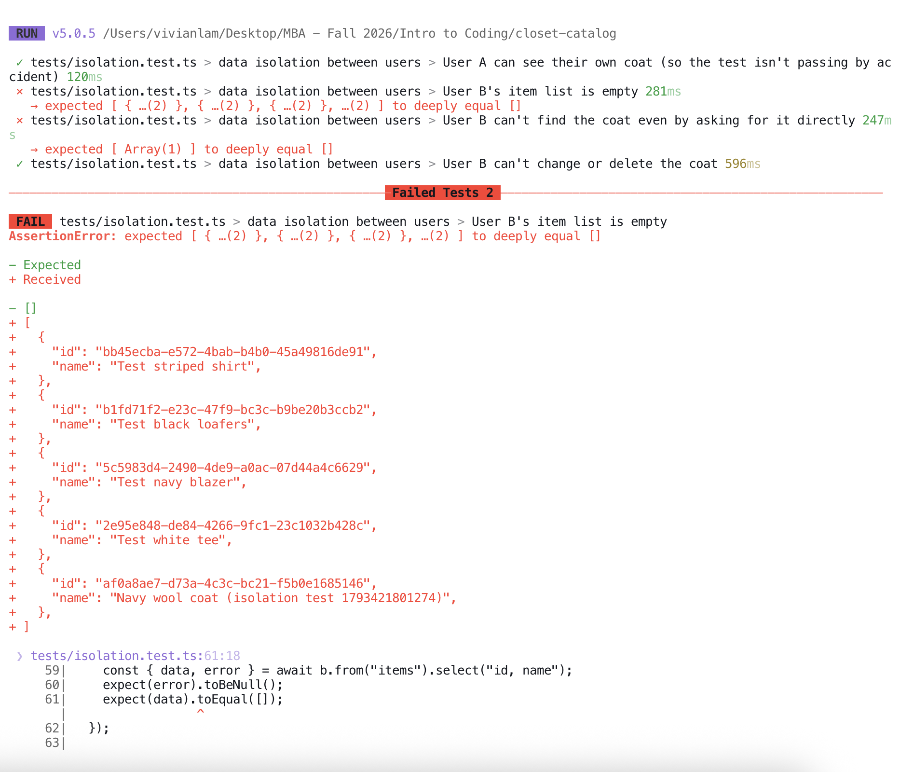
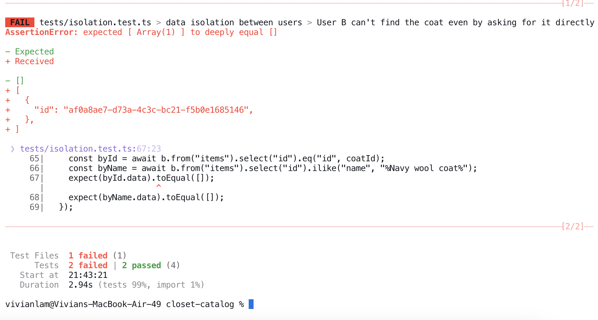
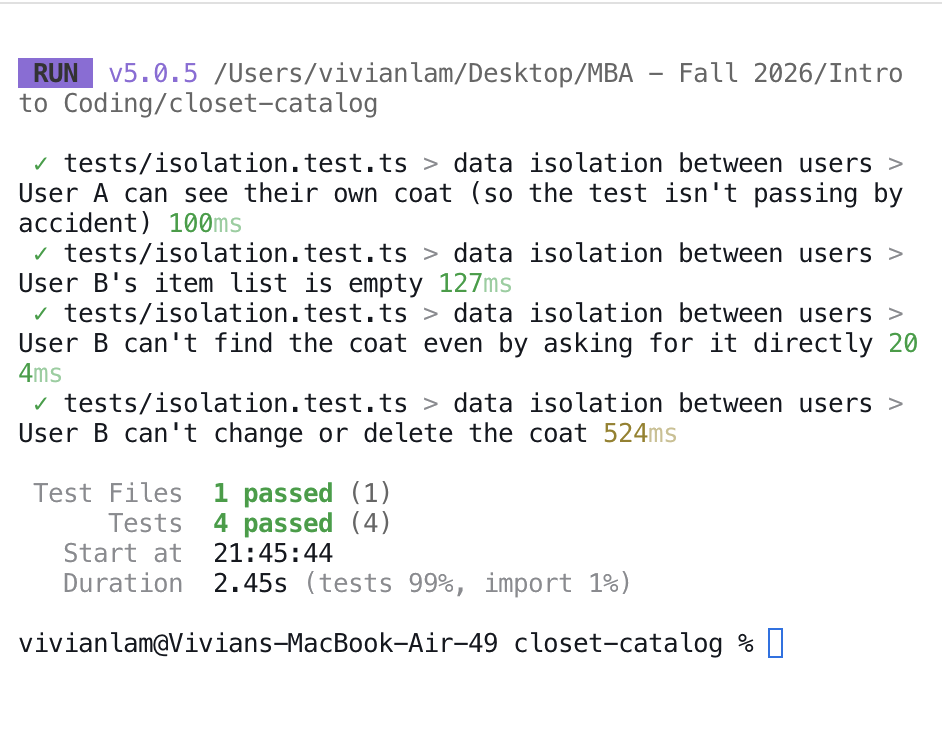
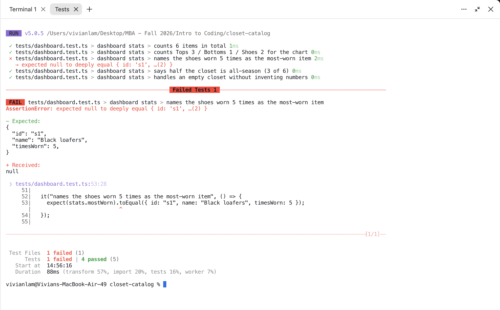
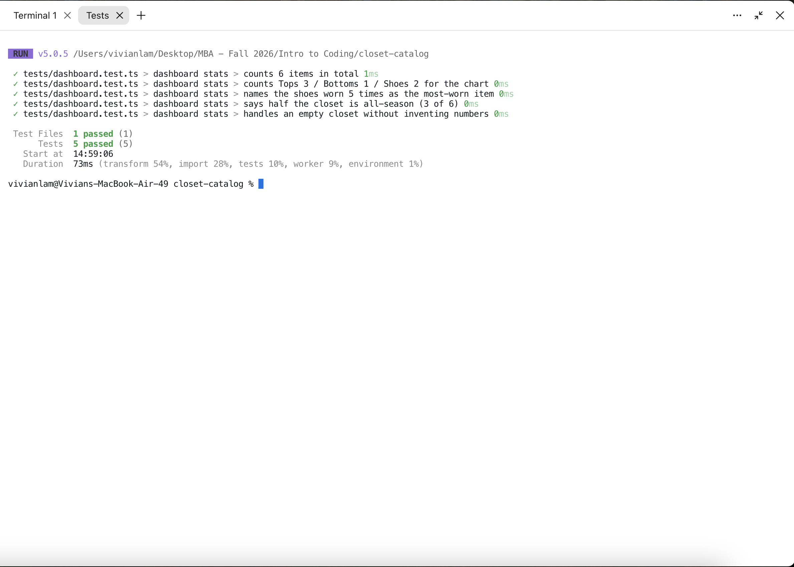

# Tests

Closet Catalog has two automated tests, the two promised in [PLAN.md](../PLAN.md) §4. They run with [Vitest](https://vitest.dev).

```bash
npm test
```

The isolation test talks to the real Supabase database, so it needs a `.env.test.local` file with the two test accounts (it's gitignored and never committed). Without that file it skips itself; the dashboard test always runs.

---

## Test 1: Data isolation

**File:** [`tests/isolation.test.ts`](../tests/isolation.test.ts)

### In plain English

The most important promise in the app is that **my closet is private**. To check it, two real test accounts log in to the real database, like two people on two phones:

1. **User A** adds a "Navy wool coat".
2. **User B**, whose closet is empty, loads their item list. They should get **nothing**.
3. User B then tries harder: asking for the coat directly by its ID, and searching by the name "Navy wool coat". Still **nothing**.
4. User B tries to rename the coat and delete it. **Neither works**, and from User A's side the coat is untouched.
5. As a sanity check, User A *can* see their own coat. This proves the test isn't passing just because the database is empty or broken.

When the test finishes, it deletes the coat, so it leaves no mess behind.

The privacy itself comes from a database rule (Supabase "Row Level Security") on the `items` table called *"Users manage their own items"*: a row can only be read or changed by the user whose ID is on it. The test checks that rule against the live database, not a pretend copy, because that's where the rule actually lives.

### Red, then green

To prove the test can actually catch a privacy leak, I briefly loosened the rule on Oct 30, 2026. I added a temporary extra rule saying *any* logged-in user can read *any* item:

```sql
create policy "TEMP demo: any logged-in user can read items"
  on public.items for select to authenticated using (true);
```

**Red:** the test failed (2 failed, 2 passed). User B could see all five of User A's items, including the Navy wool coat, and could find the coat by its ID.




The "can't change or delete" check still passed in the red run. That's expected: I only loosened *reading*, not editing.

Right away I removed the temporary rule:

```sql
drop policy "TEMP demo: any logged-in user can read items" on public.items;
```

**Green:** all 4 checks passed again.



### What would break it

- **Turning off Row Level Security** on the `items` table, or deleting the "Users manage their own items" rule. Then every logged-in user could see every item.
- **Adding any extra rule that's too generous**, like the temporary one above. Rules add up, so one loose rule opens the door even if the strict one is still there.
- **Changing the rule to check the wrong column**, or letting the app's server use Supabase's secret "service role" key, which skips every rule.
- **Bugs that don't break the rule but break the test:** if a test account's password changes or `.env.test.local` is missing, the test can't log in. (It skips itself rather than passing falsely.)

---

## Test 2: Dashboard stat

**File:** [`tests/dashboard.test.ts`](../tests/dashboard.test.ts) (checks the math in [`src/lib/dashboard.ts`](../src/lib/dashboard.ts))

### In plain English

The dashboard shows how many things I own, a chart by category, and my most-worn item. The test builds a pretend closet of 6 items:

- 3 tops, 1 pair of jeans, and 2 pairs of shoes
- the **Black loafers** have been worn **5 times**, more than anything else
- 3 of the 6 are "all-season"

It then checks the dashboard says:

- **6 items** in total
- the chart shows **Tops 3 / Bottoms 1 / Shoes 2** (and Dresses 0)
- the most-worn item is the **Black loafers (5 times)**
- **50%** of the closet is all-season
- an **empty closet** shows 0 items and no most-worn item, instead of making up numbers

This test doesn't touch the database; it checks the calculation on its own, so it runs instantly.

### Red, then green

On Oct 29, 2026, I briefly broke the most-worn calculation in `src/lib/dashboard.ts`. **Red:** the test failed (1 failed, 4 passed): it expected the Black loafers but got nothing.



I then put the code back the way it was. **Green:** all 5 checks passed.



### What would break it

- **Sorting the wrong way** (picking the *least*-worn item), or forgetting to sort at all.
- **Counting items in the wrong category**, e.g. matching categories by position instead of by ID, so shoes get counted as outerwear.
- **Dividing by zero for an empty closet**, which would show a nonsense percentage instead of nothing.
- **Renaming a category** (e.g. "Shoes" → "Footwear") without updating the test.
