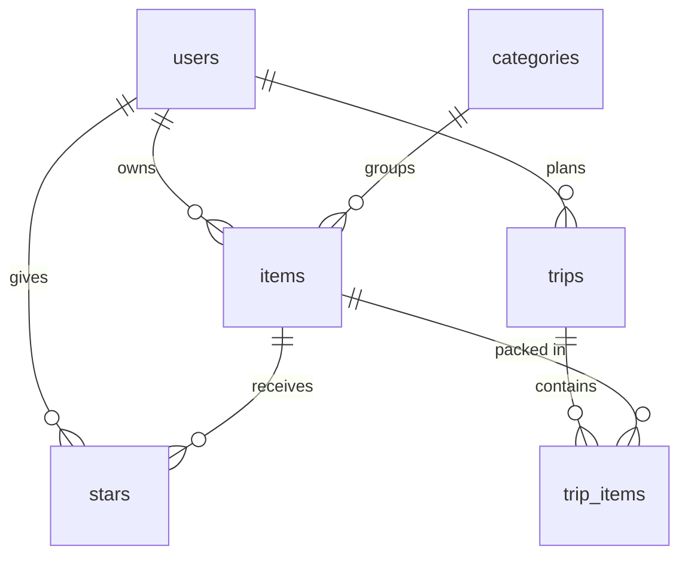

# Database schema

Closet Catalog stores everything in a **Supabase Postgres** database. The SQL that built it is in [`supabase/migrations/`](supabase/migrations/), run in order (0001 → 0004). All four have been run on the live database.

**The big idea: privacy is enforced by the database itself.** Every table has Row Level Security (RLS) turned on. RLS rules are like a bouncer on each table: even if the app asked for someone else's data by mistake, the database would hand back nothing. The [data isolation test](docs/tests.md) checks this against the real database.

## At a glance

| Table | What it holds | Who can see a row |
|---|---|---|
| `users` | One row per account | Only that user |
| `categories` | The 6 fixed categories (Tops, Bottoms…) | Everyone (no private data) |
| `items` | One row per piece of clothing | Only its owner |
| `trips` | One row per trip | Only its owner (plus the share link, see below) |
| `trip_items` | Which items are packed for which trip | Only the trip's owner |
| `stars` | Which items each user has starred | Only that user |

Plus one storage bucket, **`item-photos`**, for uploaded photos.

## Relationships

- **users → items: one-to-many.** A user owns many items; each item has one owner.
- **categories → items: one-to-many.** Each item belongs to one category.
- **users → trips: one-to-many.**
- **trips ↔ items: many-to-many, through `trip_items`.** One item can go on many trips, and one trip holds many items.
- **users ↔ items: many-to-many, through `stars`.**
- **Deleting cleans up after itself.** Deleting an item also deletes its stars and its spots on trips. Deleting a trip deletes its packing list. Deleting an account deletes everything that user owns.

## Tables

### `users`

Created automatically when someone signs up: a database trigger (`handle_new_user`) copies their account ID and email from Supabase Auth into this table.

| Column | Type | Rules |
|---|---|---|
| `id` | uuid | **Primary key.** Same ID as the Supabase Auth account. |
| `email` | text | Required, unique |
| `display_name` | text | Optional. *Not used by the app yet.* |
| `created_at` | timestamp | Set automatically |

**Privacy rules:** you can read and update only your own row.

### `categories`

A shared, pre-filled list. The app never adds or changes categories.

| Column | Type | Rules |
|---|---|---|
| `id` | small number | **Primary key** |
| `name` | text | Required, unique |
| `sort_order` | small number | The order they appear in menus and the chart |

**Contents:** 1 Tops, 2 Bottoms, 3 Dresses, 4 Outerwear, 5 Shoes, 6 Accessories.

**Privacy rules:** anyone can read them. Nobody can change them through the app.

### `items`

The main table: one row per piece of clothing.

| Column | Type | Rules |
|---|---|---|
| `id` | uuid | **Primary key**, made automatically |
| `user_id` | uuid | **Foreign key → `users.id`**. Required; filled in automatically with whoever is logged in. |
| `category_id` | small number | **Foreign key → `categories.id`**. Required. |
| `name` | text | Required, and can't be just spaces |
| `color` | text | Optional |
| `season` | text | Required: `spring`, `summer`, `fall`, `winter` or `all-season` |
| `formality` | text | Optional: `casual`, `smart casual`, `business` or `formal` |
| `brand` | text | Optional |
| `notes` | text | Optional |
| `photo_path` | text | Optional. Where an uploaded photo sits in the `item-photos` bucket. |
| `photo_url` | text | Optional. A link to a product photo on a store's website (must start with `https://`). *Added after the plan.* |
| `times_worn` | number | Starts at 0, can't go negative. The **Wore it** button adds 1. |
| `last_worn_on` | date | Optional. **Wore it** sets it to today. |
| `created_at` | timestamp | Set automatically; used for "newest/oldest" sorting |

**Privacy rule ("Users manage their own items"):** you can see, add, change and delete only rows where `user_id` is you. You also can't create an item on someone else's behalf.

### `trips`

| Column | Type | Rules |
|---|---|---|
| `id` | uuid | **Primary key**, made automatically |
| `user_id` | uuid | **Foreign key → `users.id`**. Required, filled in automatically. |
| `name` | text | Required, and can't be just spaces |
| `destination` | text | Optional |
| `start_date` | date | Optional |
| `end_date` | date | Optional. Can't be before `start_date`. |
| `climate` | text | Optional: `hot`, `warm`, `mild`, `cold` or `snow` |
| `trip_type` | text | Optional, e.g. leisure, business, wedding, trek |
| `is_shared` | true/false | Starts as false. True while the share link is on. |
| `share_token` | text | Unique. The secret random part of the share link (24 characters). Erased when sharing is turned off. |
| `created_at` | timestamp | Set automatically |

**Privacy rule ("Users manage their own trips"):** owner only. Friends see a shared trip only through the share-link function below, never through this table directly.

### `trip_items`

A "junction" table that links trips and items. Each row means "this item is on this trip's packing list."

| Column | Type | Rules |
|---|---|---|
| `trip_id` | uuid | **Foreign key → `trips.id`**. Part of the primary key. |
| `item_id` | uuid | **Foreign key → `items.id`**. Part of the primary key. |
| `packed` | true/false | Starts as false; the packing checkbox |

The primary key is the **pair** (`trip_id`, `item_id`), so the same item can't be added to the same trip twice.

**Privacy rule:** you can only see and change packing lists for your own trips, and you can only add **your own** items to them.

### `stars`

Another junction table. Each row means "this user starred this item."

| Column | Type | Rules |
|---|---|---|
| `user_id` | uuid | **Foreign key → `users.id`**. Part of the primary key. |
| `item_id` | uuid | **Foreign key → `items.id`**. Part of the primary key. |
| `created_at` | timestamp | Set automatically |

**Privacy rules:** you can see only your own stars, star only your own items, and unstar only your own stars.

## Photo storage: the `item-photos` bucket

Uploaded photos live in Supabase Storage, not in a table.

- **Private.** The bucket isn't public; the app shows photos through signed links that expire after 1 hour.
- **One folder per user:** `item-photos/<user id>/<item id>-<random>.jpg`.
- **Limits:** 2 MB per file; JPEG, PNG or WebP only. (The app crops and shrinks photos in the browser before uploading.)
- **Privacy rules:** logged-in users can view, upload and delete only files inside **their own folder**.
- **One exception, for share links:** anyone can view a photo while it's on a trip with sharing turned on (see below).

## Share links: two narrow doors

The privacy rules hide every trip from everyone but its owner, so a friend opening a share link can't read the `trips` table. Instead there are two small database functions that are allowed to look past the rules, but only return a tiny, safe slice:

- **`get_shared_trip(token)`** returns one trip's packing list, **only if** that trip has sharing on and the token matches exactly (tokens shorter than 20 characters are refused). It returns just what a friend needs: the trip's name, place, dates, climate and type, plus each item's name, category, color, brand and photo. It leaves out notes, wear counts, stars and every other trip.
- **`is_shared_photo(path)`** answers "is this photo on a currently shared trip?" The storage rule *"Anyone can read photos on shared trips"* uses it.

Both are "security definer" functions, which means they run with the database owner's permission, so they're written to return as little as possible. The app never uses Supabase's secret "service role" key, which would skip every rule.

**Known trade-off:** while a trip is shared, someone technical could list the photo bucket directly and open its photos, even without the link. Photos on unshared trips never show up. Turning sharing off hides them again. (More in [prompts/share-link.md](prompts/share-link.md).)

## Changes from the original plan

| Planned in PLAN.md §3 | What was built |
|---|---|
| `photo_path` for uploads only | Added `photo_url` too, so an item can use a store's product photo instead |
| `display_name` on users | Column exists, but the app doesn't ask for or show a name |
| Share link via a server-side lookup | Built as the `get_shared_trip` database function, plus `is_shared_photo` for photos |
